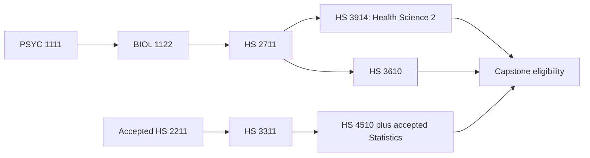

# Fastest UoPeople BS Health Science plan within US$1,000

**Verified 16 October 2026 · November 2026 starting scenario · full scholarship covering UoPeople assessment fees.**

**Further research, 16 October:** UPI Study publishes two additional mappings that could shorten the sequence. Check the conditional route below before buying the Study.com/Sophia plan. The earlier statement that November 2027 was the fastest possible finish was too strong; it was the earliest model using the providers already checked.

For the Study.com/Sophia fallback, use Pro for mapped science and health courses that shorten the university sequence. Add one month of Sophia if general education gaps justify it. Aim for two paid Study.com months, retaining a reserve for other charges. Buying credits helps only when they satisfy an outstanding requirement or release a university course slot.

**Study.com/Sophia fallback target:** approximately **January 2028 at the earliest on the UNIV + HS 1101 starting path**, with **spring 2028 as the research-capstone / later-internship scenario**. An adviser-approved PSYC 1111 start could move this sequence one term earlier. These are scheduling models, not approved graduation dates.

## 0. Potentially faster UPI route — confirmation required

UPI's chart, labelled updated 13 October 2026, claims these equivalents:

| UPI course | Claimed UoPeople requirement |
|---|---|
| Psychology 300: Psychology of Personality | PSYC 1111 Health Psychology |
| Biology 200: Intro to Biology 2 | BIOL 1122 Biology II |
| Health 120: Medical Terminology | HS 1111 Medical Terminology |

These are **provider-published mappings, not a verified individual university decision**. UoPeople confirms the partnership, but its partnership page does not independently list these course matches. [UPI chart](https://www.upistudy.com/pages/uopeople), [UoPeople partnership](https://www.uopeople.edu/about/partners/academic-partnerships/uopeople-partners-with-upi-study/)

NCCRS confirms credit recommendations for [Psychology 300](https://www.nationalccrs.org/upi-study-inc/psychology-300-psychology) and [Biology 200](https://www.nationalccrs.org/upi-study-inc/biology-200-introduction). That establishes the courses' credit recommendations, not their equivalence to UoPeople requirements. Biology 200 carries **three credits**, while BIOL 1122 requires **four and includes a virtual lab**. UoPeople must confirm full requirement/prerequisite clearance, any lab supplement, and how the missing credit is made up. Do not assume an unrelated one-credit course fixes it. [UoPeople biology requirement](https://catalog.uopeople.edu/ug_term1_item/health-science/courses-in-health-science)

### Four-term model, only if all transfer and registration conditions are approved

This model requires **83 accepted, applicable external credits**, including the PSYC and Biology II requirements, the appropriate program-elective slot and all remaining general electives. It extends the earlier pathway allocation and therefore needs a new audit. It assumes transfers can unlock January courses despite Foundations posting rules.

| Term | Remaining UoPeople courses | Credits |
|---|---|---:|
| Nov 2026–Jan 2027 | Required UNIV variant; HS 1101 | 6 |
| Jan–Mar 2027 | HS 2711; HS 3311 | 6 |
| Apr–Jun 2027 | HS 3914; HS 3610; HS 4510; HS 4212 | 12 |
| Jun–Aug 2027 | HS 3210; CHEM 3212; HS 3814; approved internship | 15 |

**39 local + 83 external = 122 credits.** This hypothetical allocation keeps January at two courses and requires four-course eligibility by April. The final term combines three courses with a 270-hour internship and is a demanding workload. All ten capstone prerequisites must be completed or accepted; the internship application while final prerequisites are in progress also needs express approval.

- **Around August 2027:** only with all those approvals and a timely internship.
- **Around November 2027:** research capstones in the June and following terms, or an internship delayed by its application rule, assuming earlier transfer/registration conditions hold.
- **Later:** if transfers cannot unlock January registration, the lab/credit gap remains unresolved, or courses/load permissions differ.

These are conditional calculations, not an established completion offer. Neither PSYC nor Biology II should be purchased on the assumption that a provider's chart overrides UoPeople's evaluation.

### Possible budget if UPI mappings are approved

UPI lists partner access at **$89/month**. A candidate mix is two UPI months ($178), one Study.com Pro month ($235), one Sophia month ($99), and the Study.com Biology I lab ($75.67): **$587.67**, leaving **$412.33** for transfers, taxes, transcript delivery and any required supplement. This is a work target, not a guaranteed package price or completion speed. [UPI partner pricing](https://www.upistudy.com/pages/uopeople)

Use UPI for the approved extra transfers and any approved overlaps such as Anatomy, Health Policy and Psychopathology; use Study.com for the remaining mapped courses. Do not buy overlapping credits twice. This budget assumes the reduced Study.com list fits one month; an extra month must be recalculated against the reserve. Any lab supplement must be approved and priced before committing.

**First decision:** ask UoPeople to confirm Psychology 300 → PSYC 1111 and Biology 200 → the complete BIOL 1122 requirement, including the credit/lab issue and January prerequisite use. If either fails, retain the applicable fallback sequence below. No current verified transfer for HS 2711 or HS 3914 was found in this review.

## 1. What changed, and what was wrong before

| Previous guide | Current finding | Action |
|---|---|---|
| Study.com: two included exams, $70 extras, five/month maximum | Pro advertises unlimited completions, three active courses, $235/month | Remove the old exam-fee arithmetic |
| Sophia A&P treated as a likely HS 2211 replacement | Its partner chart places A&P under courses without an equivalency | Use the published Study.com Biology 105 mapping |
| Four university courses assumed immediately after Foundations | Degree status, CGPA and the registration window govern the limit | Confirm when the higher load becomes available |
| Biology II, Health Science 1 and Human Development in one term | They form successive prerequisites | Keep them in separate terms |
| One-term internship assumed to save a term automatically | Application timing can add a term of waiting | Ask about applying while final prerequisites are in progress |
| All transfer fees assumed waived | Sophia's first-20-course waiver is published; a current Study.com waiver was not verified | Reserve money for charged transfers |

These findings establish that the old guide needs correction; they do not establish when each provider changed its terms. Sources: [Study.com pricing](https://study.com/college/pricing.html), [Sophia partner chart](https://partneruopeople.sophia.org/), [course prerequisites](https://catalog.uopeople.edu/ug_term1_item/health-science/courses-in-health-science), [registration rules](https://catalog.uopeople.edu/ug_term1_item/course-selection-and-scheduling/class-standing), [capstone rules](https://catalog.uopeople.edu/ug_term1_item/health-science/bachelor-of-science-in-health-science-bs-hs).

## 2. Spend the $1,000 in stages

| Item | Planned amount |
|---|---:|
| Study.com College Saver Pro, two months at $235 | $470.00 |
| Sophia, one month if needed | $99.00 |
| Biology 101L Labster access | $75.67 |
| **Subscriptions and lab subtotal** | **$644.67** |
| **Reserve within $1,000** | **$355.33** |

The lab price is published as subject to change. Sophia excludes applicable tax. Use actual checkout totals and count foreign-exchange/card charges against the budget. [Study.com prices](https://study.com/college/pricing.html), [Sophia prices](https://partneruopeople.sophia.org/), [lab syllabus and fee](https://study.com/academy/lesson/biology-101l-lab-syllabus-information.html).

Budget **$17 per charged transfer course** until the portal confirms a waiver. For example, eleven charged courses would add $187, bringing this plan to **$831.67**, with **$168.33** left for tax, transcripts and other costs. Eleven is a budget illustration, not a confirmed invoice or the number every student needs. [UoPeople welcome kit](https://files.uopeople.edu/kit/welcome_kit_ENG.pdf)

**Do not automatically buy a third Pro month.** Three Pro months, Sophia and the lab total $879.67 before transfers and taxes. With the illustrative eleven transfer charges, that becomes $1,066.67. Renew only if the actual remaining charges and work fit the cap.

If prior credits cover the Sophia targets, skip Sophia: two Pro months plus the lab are $545.67. If only general education work remains after the Pro courses, compare the $95 Study.com College Saver plan with Sophia; verify that each remaining course belongs to the cheaper plan. Neither subscription guarantees a completion rate. Cancel or pause renewals when the required work is finished.

## 3. Buy only courses the degree audit needs

### Establish the target first

UoPeople's [2025–2028 Study.com pathway](https://www.uopeople.edu/wp-content/uploads/2025/12/studycom-uopeople-degree-transfer-pathways-health-science.pdf) models **73 external credits + 49 UoPeople credits = 122**. Taking HS 1101 at UoPeople instead changes that illustrative split to **70 + 52**. Neither figure is a personal transfer award. The general 90-credit transfer ceiling is not proof that 90 useful credits are available for this degree.

Check prior accepted credits, the applicable catalog year, remaining general education categories, program electives, the local-credit requirement and proctored requirements. Prior overseas study may need a paid NACES/AICE course-by-course evaluation. Do not assume it is free or faster than mapped alternatives. [Current transfer policy, reviewed 2 September 2026](https://www.uopeople.edu/wp-content/uploads/2026/09/Transfer-Credit-Policy-09022026.pdf)

**Transfer-limit conflict to resolve:** the catalog describes 50% transfer credit with exceptions up to 75%, while the September policy permits up to 75% and the partner pathway models 73 credits. Obtain confirmation that the proposed **70–73-credit plan** is allowed for the individual degree. Do not treat the maximum as an automatic entitlement. [Catalog transfer rules](https://catalog.uopeople.edu/ug_term1_item/undergraduate-admissions/transfer-students)

### Study.com queue

These mappings come from the [official UoPeople pathway](https://www.uopeople.edu/wp-content/uploads/2025/12/studycom-uopeople-degree-transfer-pathways-health-science.pdf). Alternatives separated by “or” satisfy the same target; choose one.

| Priority | UoPeople target | Study.com course |
|---|---|---|
| First | BIOL 1121 | Biology 101 **and** Biology 101L in the PDF; resolve the ambiguity below |
| First | HS 2211 | Biology 105 |
| First | HS 2212 | Biology 103 or Biology 106 |
| First if needed | HS 1101 | Health 101 |
| Next | HS 4810 | Health 302 or Health 303 |
| Next | HS 4241 | Psychology 306 |
| Next | COM 2001 | Business 113, Business 313 or Communications 102 |
| Next | HS 3810 | Health 307 |
| Next | HS 4812 | Health 301 |
| If not covered elsewhere | HS 2611 | Nutrition 101 |
| If not covered elsewhere | MATH 1280 / MATH 1201 / SOC 1502 | Statistics 101 / Math 101 / Sociology 101 |
| If required by audit | PHIL 1404 / HIST 1421 | Philosophy 103 / History 101 or 102 |
| If not covered elsewhere | ENGL 1102 | English 204 or English 205 |

**Biology clarification before purchase:** Study.com describes Biology 101L, ACE ID SDCM-0188, as a complete **four-credit biology-with-lab course**, while the UoPeople pathway names both 101 and 101L. Ask whether 101L alone satisfies the four-credit BIOL 1121 requirement or both completions are required. Budget one lab-access fee; do not count this as seven useful degree credits. [Biology 101L description](https://study.com/academy/course/biology-101l-intro-to-biology-with-lab.html)

**Why this order:** accepted Biology I opens the Biology II route; accepted anatomy permits earlier Epidemiology; accepted infectious diseases permits Biochemistry. Transferring Health Policy avoids waiting for Health Science 2 before taking it locally. These benefits require UoPeople to accept the named equivalencies and use them to clear prerequisites.

Keep a writing/assignment-heavy course active while its marking is pending and work through another permitted slot. Complete the assessments and labs each course requires; unlimited completions does not remove those requirements or grading time. Start a paid month when there is enough time available to use it.

### Optional Sophia queue

| Sophia course | Published target |
|---|---|
| Introduction to Sociology | SOC 1502 |
| Introduction to Statistics | MATH 1280 |
| College Algebra | MATH 1201 |
| Introduction to Nutrition | HS 2611 |
| One listed English Composition option | ENGL 1102 |
| Critical Thinking; Visual Communications | Humanities, 3 credits each |
| Introduction to Ethics | Values and Ethical Reasoning category |
| Approaches to Studying Religions | Civilization Studies, Culture and Belief category |
| Distinct approved electives | Only unfilled elective space |

Category mappings do not promise specific PHIL/HIST equivalence. Confirm they clear the audit blocks; otherwise use the Study.com alternatives. The [partner chart](https://partneruopeople.sophia.org/) publishes free transfer for up to 20 Sophia courses.

Avoid false substitutes: Sophia Psychology maps to PSYC 1504, **not PSYC 1111**; Human Biology maps to BIOL 1301, **not BIOL 1121**; Microbiology is general science, not confirmed HS 2212. A&P has no listed equivalency. Foundations of Statistics is not MATH 1280. Do not duplicate equivalent English or algebra courses.

Six distinct three-credit electives would supply the pathway's 18 external elective credits, but choose them only after checking existing credit and the audit. That is a planning allocation, not an instruction to buy unnecessary courses. Retain the pathway's additional local elective slot until UoPeople approves a different allocation.

## 4. The university timetable

### The sequence that controls the finish

With Biology I and Sociology accepted, the remaining chain is:

The diagram omits already accepted prerequisites. Capstone eligibility also needs at least 80 credits and all ten specified core courses, including accepted Nutrition, Infectious Diseases and Health Policy. Research Capstone 2 follows Research Capstone 1. [Course prerequisites](https://catalog.uopeople.edu/ug_term1_item/health-science/courses-in-health-science)

**Course-code conflict:** the pathway uses HS 2712 for Health Science 2, while the current course catalog uses HS 3914. The pathway also lists HS 2720 Oral Health, while the current program-elective list includes HS 1111 Medical Terminology. Obtain a current audit and an approved crosswalk; do not assume automatic substitutions. [Program requirements and learning pathway](https://catalog.uopeople.edu/ug_term1_item/health-science/bachelor-of-science-in-health-science-bs-hs)

### Baseline: Online Education Strategies + HS 1101 in November

This is a **conditional allocation of the pathway's 52 remaining credits**, assuming 70 external credits are accepted, the course-code issue is resolved, and transfers release the indicated prerequisites. “Audit elective” means an approved three-credit course filling that particular remaining slot.

| Term | Proposed allocation | Credits |
|---|---|---:|
| 12 Nov 2026–13 Jan 2027 | Required Online Education Strategies variant; HS 1101 | 6 |
| 28 Jan–31 Mar 2027 | PSYC 1111; one audit elective | 6 |
| 8 Apr–9 Jun 2027 | BIOL 1122; HS 3311; HS 3210; CHEM 3212 | 13 |
| 17 Jun–18 Aug 2027 | HS 2711; HS 4510; HS 4212; remaining audit-approved program elective | 12 |
| Approximately Sep–Nov 2027 | HS 3914; HS 3610; HS 3814 | 9 |
| Approximately Nov 2027–Jan 2028 | HS 3995 **if approved in time**, or HS 4990 | 6 or 3 |
| Approximately Jan–Mar 2028, if needed | HS 4991, or the later approved internship | 3 or 6 |

Internship arithmetic: **6 + 6 + 13 + 12 + 9 + 6 = 52**; with 70 accepted external credits, total **122**. Research replaces the final six credits with two three-credit courses. An internship application delay can leave a waiting term rather than require another course; confirm enrollment/leave arrangements with the adviser.

Dates through August 2027 are from the [published calendar](https://www.uopeople.edu/academic-calendar/). Later windows are estimates. This is a course-completion model; degree conferral and documents can take additional time.

### Can it be one term faster?

If UoPeople permits **PSYC 1111 alongside the required UNIV course in November**, and accepts HS 1101 externally, the academic chain can move to Biology II in January, Health Science 1 in April, Health Science 2/Human Development in June, then capstone in the following term.

An illustrative 49-credit allocation is: **T1** UNIV + PSYC (6); **T2** BIOL 1122 + HS 3311 (7); **T3** HS 2711 + HS 4510 + HS 4212 + HS 3210 (12); **T4** HS 3914 + HS 3610 + HS 3814 + CHEM 3212 (12); **T5** two audit-approved three-credit elective slots + internship (12). Total **49**, plus 73 external = **122**. Research splits the internship into T5/T6. This keeps T2 at two courses, but later terms still require permission for four.

That yields a **best-case finish around November 2027**, or **around January 2028** with research or a later internship. It requires November PSYC approval; HS 1101/Biology I/Sociology usable before January registration; accepted anatomy/infectious-disease transfers available for early major courses; sufficient course-load eligibility; and capstone timing approval. Without those confirmations, keep the baseline. Do not cancel a registered course assuming its replacement will be available.

### Two administrative constraints can erase that saving

**Transfer posting:** the September 2026 policy restricts enrolled Foundations students' transfer applications until degree admission and says official posting follows completion of at least one degree course. The manual likewise ties the updated learning pathway to a completed course beyond Foundations. Ask when an approved transfer can actually unlock registration. Sending a transcript in December does not establish January eligibility. [Policy](https://www.uopeople.edu/wp-content/uploads/2026/09/Transfer-Credit-Policy-09022026.pdf), [transfer manual](https://files.uopeople.edu/guide/transfer_credit_ENG.pdf)

This also affects the baseline: if the first degree course ends in March, confirm that transfers can unlock the April courses in time. If UoPeople requires later audit posting, move the affected sequence back at least one term. The finish windows above are not a guaranteed upper bound.

**Internship application:** apply by the end of Week 1 of the preceding term, with host and onsite-supervisor agreements. The catalog also describes eligibility after completing the core courses. Ask whether a conditional application is permitted while final core courses are in progress. Otherwise, plan a later internship or the research route. The internship requires 270 onsite hours, normally 30 per week over nine weeks; arrange it at least two terms ahead. [Capstone requirements](https://catalog.uopeople.edu/ug_term1_item/health-science/bachelor-of-science-in-health-science-bs-hs)

Foundations normally permits at most two courses. Degree-seeking students with CGPA at least 3.00 may take up to four, but improved grades do not permit an immediate late-registration increase. Confirm the actual allowance. Four courses imply roughly **60–68 study hours weekly** under university guidance. [Class standing](https://catalog.uopeople.edu/ug_term1_item/course-selection-and-scheduling/class-standing)

## 5. Execute in this order

1. **Now:** obtain the audit and confirm which catalog governs it. Reconcile prior credit before selecting general education or electives. Resolve Biology 101L and the course-code discrepancies.
2. **Before changing November registration:** ask about PSYC and early transfer-prerequisite use. Published regular registration closes **21 October 2026**. The portal's account-specific eligibility controls what can be selected.
3. **External month one:** prioritize the accepted Biology I route, Anatomy, Infectious Diseases, Sociology and Statistics; add Health 101 only if HS 1101 will be transferred. Start assessed writing early. Take Sophia only if its approved targets justify a month.
4. **External month two:** complete Health Policy and remaining mapped health/communication courses, then only outstanding general education/elective gaps. Send finished prerequisites promptly rather than waiting for the whole block.
5. **Registration checkpoints:** January term registration is **10–30 December 2026**; April is **25 February–17 March 2027**; June is **6–26 May 2027**. Aim to resolve transfers several weeks earlier. These windows do not guarantee a last-minute transfer will be usable. [Academic calendar](https://www.uopeople.edu/academic-calendar/)
6. **Each renewal:** total spending, committed charges and remaining work. A third subscription month must fit the actual reserve within $1,000.
7. **Each university term:** protect the CGPA needed for the planned load, confirm next-term availability and update the audit. Begin capstone arrangements before the final prerequisite term.

Track each external course through **planned → completed → transcript sent → accepted → posted to the correct audit requirement → prerequisite released**. Keep student records private. The [manual](https://files.uopeople.edu/guide/transfer_credit_ENG.pdf) gives the portal path **Admissions → Transfer Credits → New Request**, warns of processing delays and notes that audit posting can take weeks.

## 6. Adviser checklist before committing to the fastest dates

This is a draft checklist; no message is implied to have been sent.

- Which catalog and codes govern my audit, including Health Science 2, the Oral Health/Medical Terminology elective slot and my required UNIV variant?
- For the UPI option, do Psychology 300 and Biology 200 fully satisfy PSYC 1111 and BIOL 1122? What lab/credit supplement, if any, is required, and is an 83-credit external allocation with the proposed remaining 39 credits acceptable?
- Can PSYC 1111 be taken in November, and when can external prerequisites be used for January registration given Foundations/degree-student rules?
- Does Biology 101L (SDCM-0188, four credits) alone satisfy BIOL 1121, or is Biology 101 also required?
- Please confirm approval for 70–73 external credits despite the catalog's 50%/exception wording, the Study.com mappings, Sophia category application, remaining electives and any course-specific restrictions.
- When can I register for four courses, and can accepted transfers unlock the proposed early Epidemiology/Human Diseases/Biochemistry placements?
- Can I apply for an internship in Week 1 while final core prerequisites are in progress? If not, what are my earliest internship and research-capstone terms?
- Which transfer charges are waived, and how do accepted transfers satisfy the proctored-course requirements?

The current policy accepts transfer credit for courses with proctored exams. Verify the resulting audit rather than assuming the remaining local schedule automatically supplies eleven exams. Follow current automatic classroom proctoring instructions; the old personal-proctor cost advice has been removed. [Transfer policy](https://www.uopeople.edu/wp-content/uploads/2026/09/Transfer-Credit-Policy-09022026.pdf), [proctored-exam rules](https://catalog.uopeople.edu/ug_term1_item/academic-regulations/proctored-exams)

## Scope of this update

Prices, mappings and policy sources were checked on 16 October 2026. Schedules and spending allocations are this guide's calculations. Course offerings, individual transfer decisions, scholarship duration, exact taxes and future calendar dates remain student-specific or unpublished. Publishing this guide does not purchase courses, change registration, submit transfers or send adviser messages.
